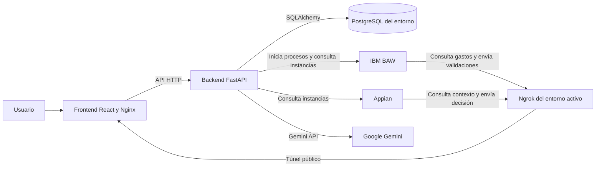

# Arquitectura de Expensr

Expensr se ejecuta mediante Docker Compose o Kubernetes. En ambos casos, el frontend se comunica con FastAPI y el backend guarda los datos en PostgreSQL. BAW y Appian se integran con el backend mediante API.

## Flujo de un gasto

1. El usuario sube una factura o introduce los datos del gasto.
2. Si sube un archivo, el backend solicita a Gemini la extracción de fecha, importe, categoría y concepto. El usuario revisa los datos antes de registrar el gasto.
3. El backend guarda el gasto en PostgreSQL con estado inicial `PENDIENTE_BAW` e intenta iniciar el proceso correspondiente en BAW.
4. BAW consulta el gasto y comunica al backend los datos de validación y el resultado de su revisión.
5. La integración con Appian permite obtener los datos financieros, registrar la decisión y guardar el estado final en Expensr.
6. El monitor lee PostgreSQL y consulta las fuentes externas. Si una fuente no responde, puede mostrar los datos disponibles junto con un aviso.

## Acceso desde los motores BPM

BAW y Appian están alojados fuera del clúster local. Ngrok crea un túnel público hacia el frontend del entorno elegido; Nginx reenvía las rutas de API al backend.

- En Docker Compose, el servicio ngrok definido en `docker-compose.yml` apunta al servicio `frontend` de Compose.
- En Kubernetes, `k8s/ngrok.yaml` apunta al Service `expensr-frontend`.

Compose y Kubernetes tienen bases de datos distintas. Para que una llamada BPM lea y actualice los datos del entorno esperado, el dominio público de ngrok debe dirigir el tráfico a ese entorno.

## Persistencia

El backend es el único componente que accede directamente a PostgreSQL. BAW y Appian usan la API de Expensr; no tienen conexión JDBC ni un Data Store de Appian conectado a esta base.
